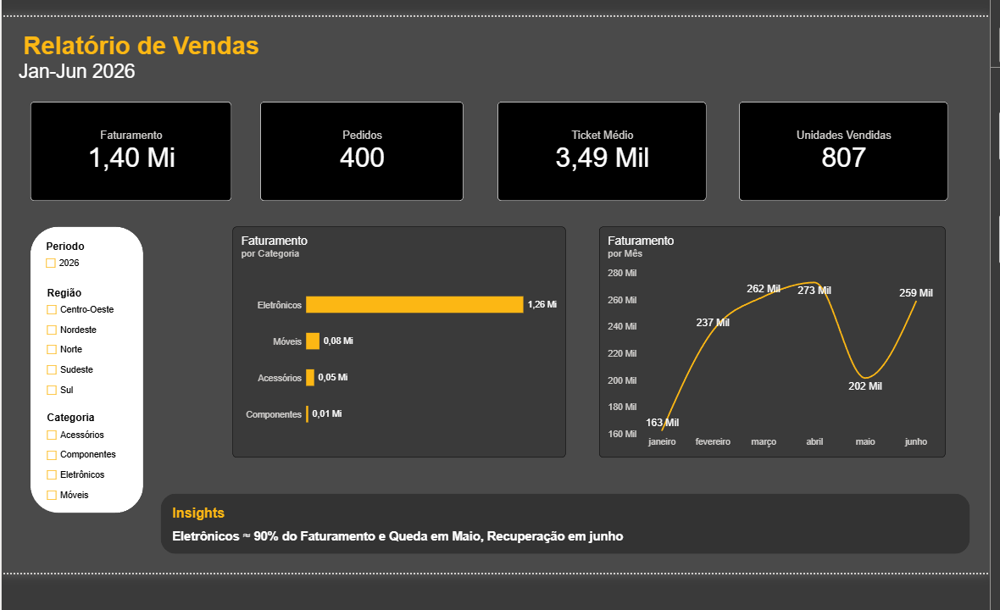
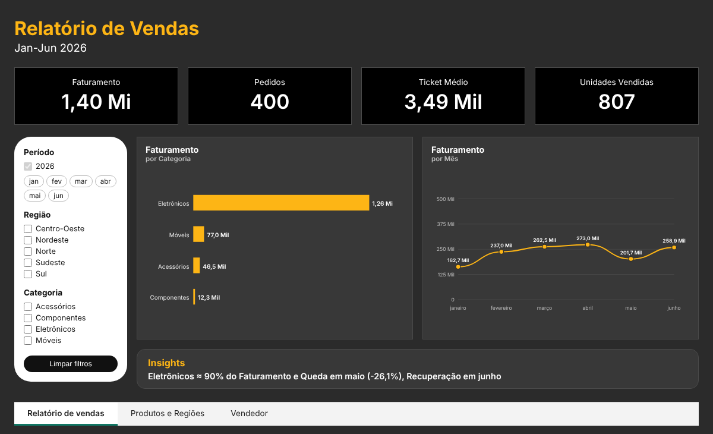

# Análise de Vendas e Performance Comercial

Projeto de portfólio em análise de dados: do banco de dados ao dashboard. Os dados são simulados (400 pedidos, jan–jun/2026) e permitem responder perguntas como: qual categoria concentra a receita, como o faturamento evolui por mês, quais regiões e vendedores têm melhor desempenho.

## Principais resultados

- Faturamento total: R$ 1,40 Mi em 400 pedidos (ticket médio de R$ 3.489,46)
- Eletrônicos concentra ~90% da receita, um ponto de atenção de dependência de categoria
- Maio teve queda de 26% sobre abril, e junho recuperou 28%
- Sudeste responde por ~45% do faturamento
- Aline Barros lidera em faturamento e em ticket médio

Detalhes e tabelas completas em [`CONCLUSOES.md`](CONCLUSOES.md).

## Dashboard



Versão web (mesmo layout, interativa):



A versão web interativa em [`docs/`](docs/index.html) reproduz o layout do relatório do Power BI, com filtros por mês, região e categoria (HTML, CSS e JavaScript, sem dependências externas).

## Tecnologias

| Etapa | Ferramenta |
|---|---|
| Modelagem e consultas | SQL (PostgreSQL) |
| Geração dos dados | Python (pandas, numpy) |
| Dashboard | Power BI (DAX) |
| Versão web | HTML, CSS e JavaScript |

## Estrutura do repositório

```
├── dados/        CSVs: clientes, produtos, vendedores, vendas
├── sql/          Criação das tabelas e 7 consultas analíticas (analises.sql)
├── scripts/      gerar_dados.py (dados reprodutíveis) e testar_consultas.py
├── powerbi/      Relatório .pbix e print do dashboard
├── docs/         Dashboard web interativo (HTML, CSS e JS)
└── CONCLUSOES.md Resultados e insights da análise
```

## Modelo de dados

Esquema estrela com a tabela fato `vendas` e as dimensões `clientes`, `produtos` e `vendedores`.

## Como executar

**1. Gerar os dados** (opcional, os CSVs já estão no repositório; a semente fixa garante o mesmo resultado)

```bash
pip install -r requirements.txt
python scripts/gerar_dados.py
```

**2. Validar as consultas SQL** (roda as 7 consultas em SQLite e imprime os resultados)

```bash
python scripts/testar_consultas.py
```

**3. Usar no PostgreSQL**

Execute `sql/analises.sql` para criar as tabelas e importe os CSVs da pasta `dados/` (pgAdmin ou DBeaver). Depois rode as consultas do arquivo.

**4. Abrir o dashboard**

Abra `powerbi/Relatorio de vendas.pbix` no Power BI Desktop. Os dados já estão embutidos no arquivo, então ele abre sem precisar dos CSVs.

Para atualizar os dados, aponte a fonte para a pasta `dados/` do seu computador em **Transformar dados → Configurações da fonte de dados**. Os CSVs usam ponto como separador decimal, então as colunas numéricas são importadas com a localidade **Inglês (Estados Unidos)**. Se, depois de atualizar, os valores aparecerem 10 vezes maiores (13,96 Mi em vez de 1,40 Mi), refaça essa configuração: apague a etapa "Tipo Alterado" da tabela, clique com o botão direito nas colunas numéricas → **Alterar Tipo → Usando Localidade...** → **Número Decimal** e **Inglês (Estados Unidos)**.

## Aviso

Os dados são fictícios e servem para fins educacionais e de portfólio. Não representam uma empresa real.

## Autor

Lukas da Silva Santos, estudante de Ciência de Dados, em busca de oportunidade como Analista de Dados Júnior.
GitHub: [Lukassantos56](https://github.com/Lukassantos56)


